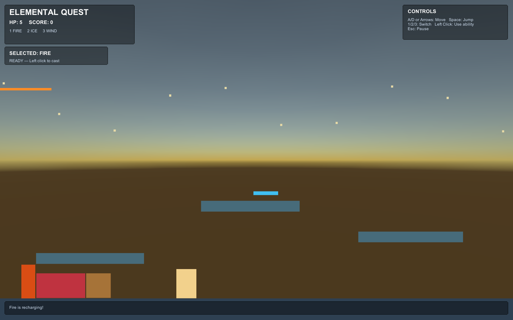

# 🎮 Elemental Quest — Unity 2D Game

A 2D elemental action-adventure platformer built using **Unity 2022.3 LTS and C#**.

## 🎯 Game Overview

Elemental Quest is a platform game where players explore a level, avoid enemies and obstacles, and use three elemental abilities to overcome challenges.

## ✨ Features

- Player movement and jumping
- Fire, Ice and Wind abilities
- Elemental projectile system
- Enemy interactions and health system
- Score tracking
- Pause, Game Over and Restart functionality
- Interactive platform challenges

## 📸 Gameplay Screenshot

## 🎮 Controls

| Key | Action |
|---|---|
| A / Left Arrow | Move left |
| D / Right Arrow | Move right |
| Space | Jump |
| 1 | Select Fire |
| 2 | Select Ice |
| 3 | Select Wind |
| Left Click | Use selected ability |
| Esc | Pause |

## 🛠️ Technologies Used

- Unity 2022.3 LTS
- C#
- Visual Studio Code
- Git and GitHub

## 🚀 How to Run

1. Clone or download this repository.
2. Open the project using Unity Hub.
3. Select Unity 2022.3 LTS.
4. Open `Assets/Scenes/ElementalQuest.unity`.
5. Press Play.

## 👨‍💻 Developer

**Sai Vardhan**

GitHub: [saivardhan-72638](https://github.com/saivardhan-72638)

---

*Developed as part of the YUVA Intern Week 1 Game Feature Planning and Design Document assignment.*
